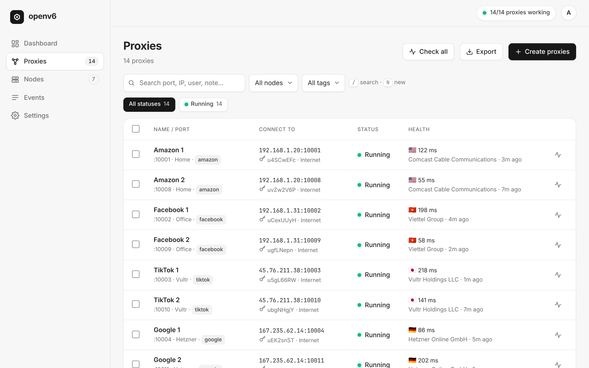

<p align="center"></p>
<h1 align="center">openv6</h1>
<p align="center"><b>用你自己网络的 IPv6 生成静态代理（HTTP + SOCKS5），一个网页面板统一管理。</b></p>
<p align="center"><a href="https://thephuc.xyz/openv6/">官网</a> · <a href="https://github.com/synthcoz/openv6/releases/latest">下载</a> · <a href="CHANGELOG.md">更新日志</a></p>
<p align="center"><a href="README.md">English</a> · <a href="README.vi.md">Tiếng Việt</a> · <b>简体中文</b> · <a href="README.es.md">Español</a> · <a href="README.ru.md">Русский</a> · <a href="README.pt-BR.md">Português</a></p>



openv6 把家庭宽带或 VPS 服务商分配给你的 IPv6 前缀变成数百个固定代理，每个账号一个。专为指纹浏览器设计（Multilogin、GoLogin、Dolphin Anty、ixBrowser、AdsPower、MoreLogin…）。

- **每个代理一个固定 IPv6。** 每个代理都有独立的端口、用户名、密码和出口 IPv6，在你修改之前保持不变。
- **任何 IPv6 网络。** 家庭宽带（局域网内的 /64；运营商更换前缀时 openv6 自动跟随，端口和密码不变）以及路由了 /64、/56 或 /48 的 VPS 或自建服务器。
- **客户端通过 IPv4 连接**（机器的局域网 IP 或 VPS 的公网 IP），流量通过 IPv6 出口。
- **Windows、macOS 和 Linux。** 任何一台都可以运行代理（称为节点），多台机器在同一个面板中管理。
- **自动检测与修复。** 定期检测出口 IP，清楚说明错误原因，一键修复，Telegram 告警。
- **开着 VPN 也稳定**，可通过 VPS 中继、UPnP 或 Tailscale 共享到局域网以外。
- **单一可执行文件。** 无需 Docker，无需另装代理服务器。面板支持英文和越南文，浅色和深色，手机上也好用。

## 安装

| 系统 | 方法 |
|---|---|
| **Windows 10/11** | 从 [Releases](https://github.com/synthcoz/openv6/releases/latest) 下载 `openv6-setup-windows-amd64.exe`，点击 Next → Install。 |
| **macOS** （Intel 与 Apple 芯片） | 从 Releases 下载 `openv6-macos.pkg`。 |
| **Ubuntu / Debian / Zorin** (amd64, arm64, armhf) | 使用下面的命令，或 Releases 中的 `.deb` 文件。 |

```bash
curl -fsSL https://raw.githubusercontent.com/synthcoz/openv6/main/install.sh | sudo bash
```

openv6 在后台运行并随系统启动。托盘图标显示状态并可打开面板。

1. 打开面板（`http://<本机局域网IP>:8080`，或点击托盘图标）并创建管理员账号。
2. **Proxies → Create proxies**，然后按指纹浏览器的格式 **Export**。
3. 局域网内的所有设备使用 `本机局域网IP:端口`（或 VPS 公网 IP）。

添加其他机器（VPS、迷你主机、其他电脑）：**Nodes → Add node**，然后在那台机器上运行显示的命令。

## 免费版与专业版

| | Free | Pro（一次性付费） |
|---|---|---|
| 代理数量 | 3 | 不限 |
| 运行代理的机器 | 1 | 多台（VPS、迷你主机、电脑） |
| HTTP + SOCKS5、导出、自动检测 | ✓ | ✓ |
| 中继 / UPnP / Tailscale 共享、API、客户账号、Telegram、每个代理指定网卡 |  | ✓ |

在[官网](https://thephuc.xyz/openv6/#pricing)购买授权，然后在 **Settings → License** 中输入。

## 命令

```
openv6 server  [-listen :8080] [-data DIR] [-no-local-agent] [-tls-cert FILE -tls-key FILE]
openv6 agent   -panel URL -token TOKEN [-data DIR]
openv6 install server|agent [flags]   # 安装为系统服务（root / 管理员）
openv6 uninstall                      # 移除服务及 openv6 添加的所有 IPv6
openv6 tray                           # 托盘图标
openv6 reset-password [-data DIR] [-user NAME]
openv6 version
```

## 文档

详细指南目前为越南文。

| 文件 | 内容 |
|---|---|
| [docs/WINDOWS.md](docs/WINDOWS.md) | Windows 10/11：托盘图标、有线/Wi-Fi、防火墙 |
| [docs/ZORIN.md](docs/ZORIN.md) | 在 Zorin OS / Ubuntu 上逐步安装 |
| [docs/HUONG-DAN.md](docs/HUONG-DAN.md) | 完整指南：检查 IPv6、家庭宽带、VPS、故障排除 |
| [docs/API.md](docs/API.md) | JSON API 与 API 令牌 |
| [docs/ARCHITECTURE.md](docs/ARCHITECTURE.md) | 架构、IPv6 分配、面板 ↔ 节点协议 |
| [docs/RELEASE.md](docs/RELEASE.md) | 发布新版本、签名更新 |

## 开发

```bash
make test   # 单元测试
make dev    # 以 -dry-run 模式运行面板（不改动网络配置）, http://localhost:18080
make dist   # 构建 Linux 版本到 dist/
```

落地页位于 [`site/`](site)，部署在 Cloudflare 上（见 [deploy/cloudflare](deploy/cloudflare)）。
